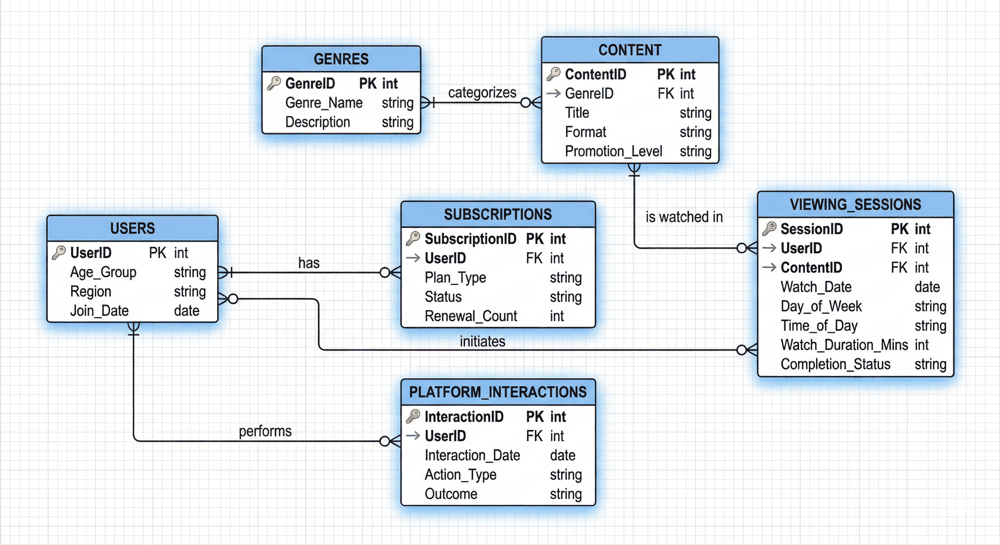
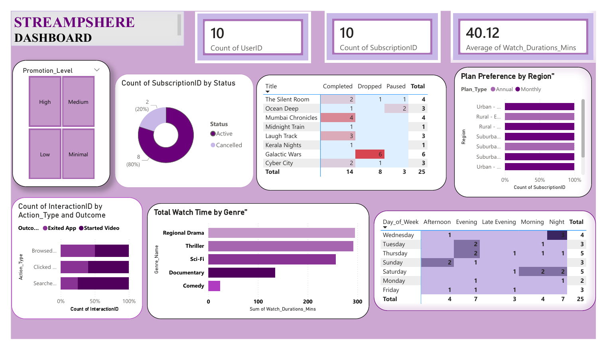

# StreamSphere: The Engagement Puzzle (SQL & Power BI)

A relational database, analytical SQL reports and a Power BI dashboard for a fictional regional streaming platform, aimed at understanding *why* users browse, pause, abandon content and cancel.

## Business challenge
StreamSphere could see *what* users did but not *why*. The project focuses on three questions: is promoted content actually watched, does browsing without watching signal churn, and what does pausing say about engagement?

## Database design (MySQL)
Six normalised tables linked by primary and foreign keys:



| Table | Holds |
|---|---|
| `USERS` | Age group, region, join date |
| `GENRES` | Genre name and description |
| `CONTENT` | Title, format, genre, promotion level |
| `SUBSCRIPTIONS` | Plan type, status, renewal count |
| `VIEWING_SESSIONS` | Watch date, day / time slot, duration, completion status |
| `PLATFORM_INTERACTION` | Browse / click / search actions and their outcome |

The script loads a small illustrative sample (10 users, 8 titles, 25 viewing sessions; row counts in `data/table_row_counts.csv`).

## SQL analysis
`streamsphere_analysis.sql` builds the schema, loads the sample, runs row-count checks, then seven reports:
1. Content engagement and completion
2. Subscription health
3. User interaction friction
4. Peak traffic and behavioural heatmap (day × time slot)
5. Demographic consumption
6. High-engagement content: titles whose total watch time beats the platform average (subquery + `HAVING`)
7. Demographic deep-dive on promoted genres (three-table `JOIN` + subquery)

Techniques: multi-table `JOIN`s, `GROUP BY` / `HAVING`, subqueries, conditional aggregation with `CASE`.

## Power BI dashboard



KPI cards, subscription status, completion by title, plan preference by region, interaction outcomes, watch time by genre and a day × time-of-day heatmap, with a promotion-level slicer.

## Insights from the project report
The report scales the analysis to a simulated 5.5-million-interaction scenario and reports:
1. **Visibility paradox:** heavily promoted (Tier 1) content drew 2.1M+ views but a 44.2% early-exit rate.
2. **Browse fatigue predicts churn:** users browsing over 10 minutes without watching churned at 52.6%, versus 9.4% for intentional viewers.
3. **Pausing as a signal:** 1–3 pauses went with an 89.5% completion rate; 4+ pauses with only 31.4%.

## Recommendations
- **Change the headline KPI** from raw views to start-to-completion ratio.
- **Weight completion above clicks** in recommendations to break misleading feedback loops.
- **Intervene in real time:** prompt a "Surprise me" pick after 10 minutes of browsing.

## Repository structure
```
├── streamsphere_analysis.sql      # Schema, sample data, checks and 7 analytical reports
├── data/
│   └── table_row_counts.csv
├── images/                        # ER diagram and dashboard screenshot
└── reports/
    ├── report.pdf                 # Full project report
    ├── powerbi_dashboard.pdf      # Dashboard export
    ├── presentation.pptx
    └── stage1_business_understanding.docx
```

## How to run
Run `streamsphere_analysis.sql` in MySQL 8 (Workbench or CLI). It creates the `Streamsphere` database, loads the sample data and returns each report.

## Tech stack
MySQL · Power BI · ER modelling
